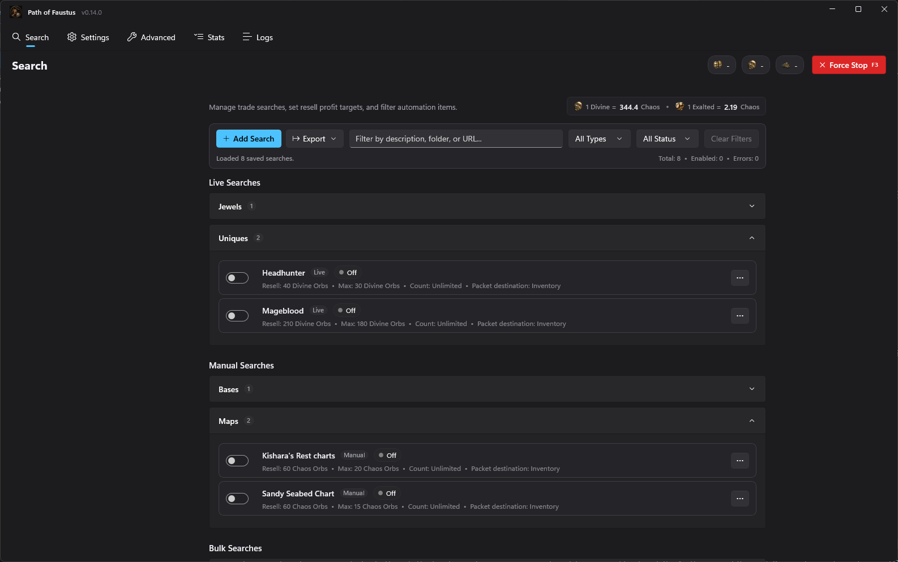
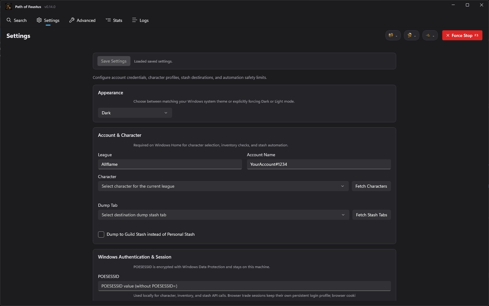
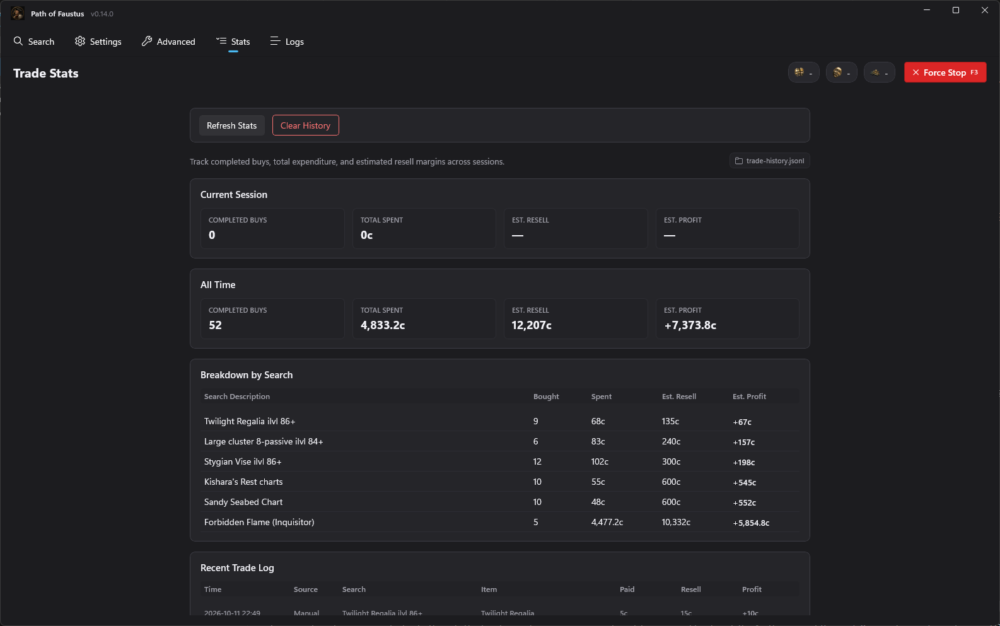
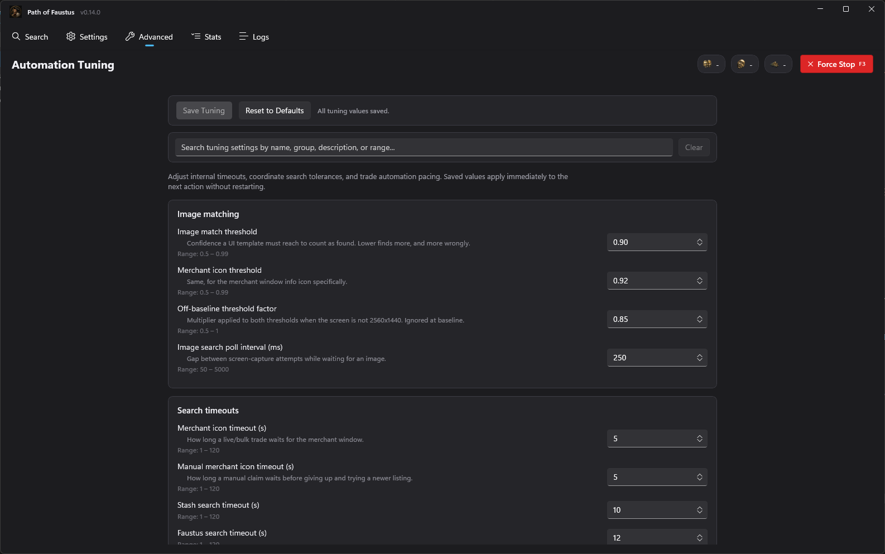

<p align="center">
  
</p>

# Path of Faustus

A free Windows desktop app for Path of Exile trading. Save your trade searches, and Path of Faustus watches them and buys matching items in your own game client. It also tracks what you spent and the profit you can expect from reselling.

**[Download the latest release](https://github.com/jpitty03/PathOfFaustus-Releases/releases/latest)**

> Path of Exile 1 only. Path of Exile 2 is not supported.
>
> Path of Faustus buys items that players list in their hideouts. Currency and divination cards trade through the Faustus exchange instead, so the app can't buy them.



## Features

- **Live searches:** follows the trade site's live search and buys new listings as they appear.
- **Manual searches:** works through a search's listings one by one, travelling to each seller and buying.
- **Bulk searches:** re-runs a trade search on a timer you choose and buys every listing under your max price.
- **Folders and filters:** group searches into folders and filter them by type, status or text.
- **Price limits:** each search has a max buy price in chaos, divine or exalted orbs, and a resell price for searches that list with Faustus.
- **Currency guard:** stops a search once your chaos and divine orbs no longer cover its max price.
- **Per-search destination:** each search chooses where its purchases go: a dump tab in your personal stash, the guild stash, or a Faustus listing at the resell price.
- **Scheduled breaks:** pauses automation for a set number of minutes at the interval you choose.
- **Force stop hotkey:** `F3` stops everything at once. You can change the key in Settings.
- **Trade stats:** shows completed buys, total spent, estimated resell value and profit, per search and overall.
- **Tuning:** adjust image-match thresholds, timeouts and pacing without restarting.

## Requirements

- Windows 10 (version 1809 or later) or Windows 11, 64-bit.
- Microsoft Edge WebView2 Runtime. Windows 11 and most updated Windows 10 PCs already have it. If yours doesn't, install it with [Microsoft's Evergreen Bootstrapper](https://go.microsoft.com/fwlink/p/?LinkId=2124703).
- Path of Exile running on the same PC. The app finds the game's buttons on screen; it is tuned for 2560x1440 and scales its matching for other resolutions.

You don't need to install .NET separately. The download includes everything else it needs.

## Install

1. Download `PathOfFaustus-vX.Y.Z-win-x64.zip` from the [latest release](https://github.com/jpitty03/PathOfFaustus-Releases/releases/latest).
2. Extract both files, `PathOfFaustus.exe` and `PathOfFaustus.pri`, to the same folder.
3. Run `PathOfFaustus.exe`.

The first launch of each new version takes a few extra seconds while the app unpacks itself to `%TEMP%\.net\PathOfFaustus`. Later launches start normally.

The app isn't code-signed, so Windows SmartScreen may warn you the first time you run it. Click **More info**, then **Run anyway**.

Each release lists the zip's SHA-256 hash in a `.sha256` file. To check your download, run this in PowerShell:

```powershell
Get-FileHash .\PathOfFaustus-vX.Y.Z-win-x64.zip -Algorithm SHA256
```

## Getting started

1. **Settings:** enter your league and account name, and paste your `POESESSID`, the session cookie from pathofexile.com. Click **Fetch Characters** and **Fetch Stash Tabs**, then pick a character and a dump tab, and save.
2. **Search:** click **Add Search**, paste a pathofexile.com trade search URL, choose Live, Manual or Bulk, and set a max price and resell target.
3. **Sign in:** if the app asks you to sign in, log in to pathofexile.com in its search window. It keeps that login for later.
4. Start the game, turn the search on, and leave the game window visible. Press `F3` to stop at any time.

| Settings | Trade stats |
| --- | --- |
|  |  |

| Automation tuning |
| --- |
|  |

## Your data

- Settings, saved searches and trade history are stored on your PC in `%LOCALAPPDATA%\PathOfFaustus\`.
- Your `POESESSID` is encrypted with Windows Data Protection and never leaves your PC, except in requests to pathofexile.com.
- Logs are in `%LOCALAPPDATA%\PathOfFaustus\logs\`. The **Export Diagnostics** button on the Logs page bundles them for a bug report.

## Updating

The app checks for a new version each time it starts. When one is available, a banner offers to download it; your searches keep running during the download, and you choose when to restart. Your settings and searches are kept, because they are stored separately in `%LOCALAPPDATA%`.

Updating needs write access to the folder the app runs from. If it is under `C:\Program Files`, download the new zip by hand instead.

## License key

Settings has a License card. A key unlocks a few extra features: trade stats, guild stash dumping, listing purchases with Faustus, and search export. Everything else works without one. A key works on one computer, the first to activate it; removing and re-entering it on the same computer is fine.

## Reporting bugs

Open an [issue](https://github.com/jpitty03/PathOfFaustus-Releases/issues). Include the version shown in the title bar and attach the export from **Logs → Export Diagnostics**.

## Disclaimer

Path of Faustus is a third-party tool. It is not affiliated with or endorsed by Grinding Gear Games. Automating actions in Path of Exile may break the game's Terms of Use and could get your account suspended. You use it at your own risk.

*The screenshots use sample data.*
